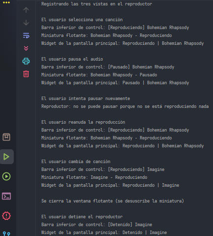

# Ejercicio 02 - Sincronizador de Interfaz para Reproductor Multimedia

## Descripción

Una aplicación de música muestra el estado de reproducción en tres vistas: una barra inferior de control, una ventana flotante de miniatura y un widget en la pantalla principal. Cuando cambia la canción o el estado (reproduciendo, pausado, detenido), todas las vistas deben reflejarlo al instante.

## Objetivos

- Desacoplar el estado central del reproductor de sus representaciones visuales.
- Evitar el polling: las vistas reaccionan solo a las notificaciones.
- Encapsular de forma segura la gestión de la lista de observadores.

## Implementación del patrón Observer

Se usa la variante push con estado: el reproductor envía a los observadores el estado y el título de la canción.

- **Sujeto:** `MediaPlayer` guarda el estado y el título, y administra la lista de observadores.
- **Observador:** `PlayerObserver` declara `onPlayerChanged(PlaybackState state, String songTitle)`.
- **Observadores concretos:** `BottomControlBar`, `FloatingThumbnail` y `HomeWidget`.
- **Seguridad de la lista:** se usa `CopyOnWriteArrayList`, que permite agregar o quitar vistas incluso mientras se notifica.
- **Flujo:** `changeSong`, `pause`, `resume` y `stop` modifican el estado y disparan la notificación.

## Propósito de la clase

- `PlaybackState`: enumeración con los estados del reproductor.
- `PlayerObserver`: interfaz común de las vistas.
- `MediaPlayer`: motor de reproducción y sujeto observable.
- `BottomControlBar`: barra inferior de control.
- `FloatingThumbnail`: ventana flotante de miniatura.
- `HomeWidget`: widget de la pantalla principal.
- `Main`: simula la interacción del usuario y cierra la miniatura a mitad de la ejecución.

## Concepto clave

Las vistas no le preguntan nada al reproductor: es él quien las avisa cuando algo cambia. Así se evita el polling y se mantiene la sincronización en todas las vistas.

## Resultado

## Conclusión

Con Observer, el reproductor no depende de cuántas vistas existan ni de cómo se dibujan. Agregar una nueva vista solo requiere implementar `PlayerObserver` y suscribirla, y las vistas se mantienen sincronizadas sin consultas periódicas.
